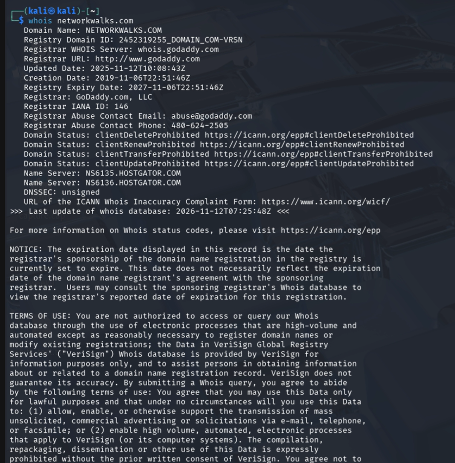
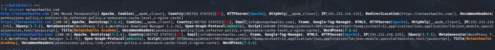
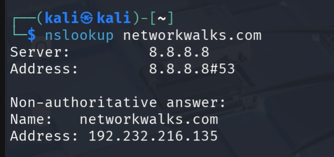
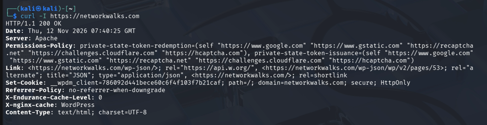
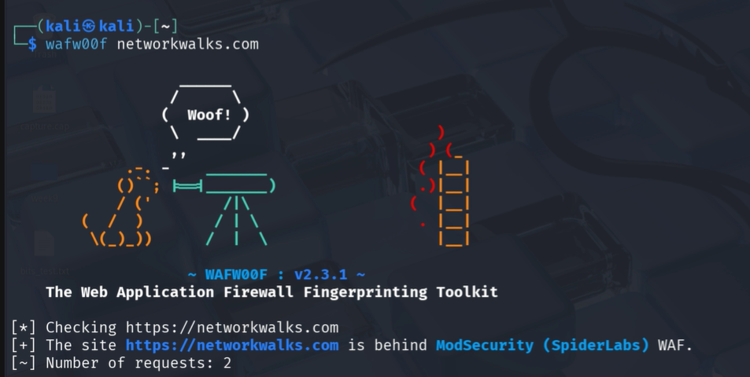
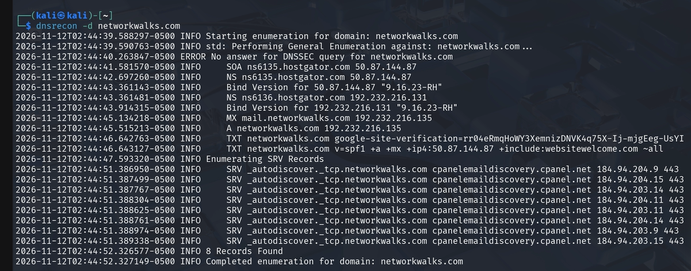
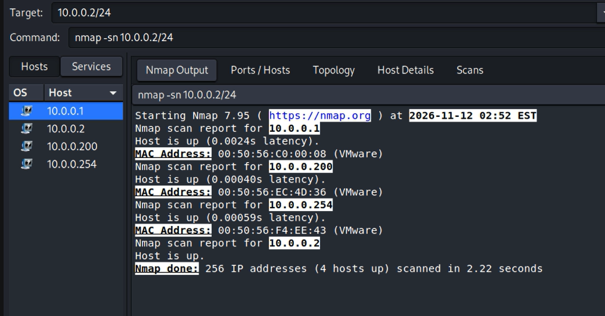
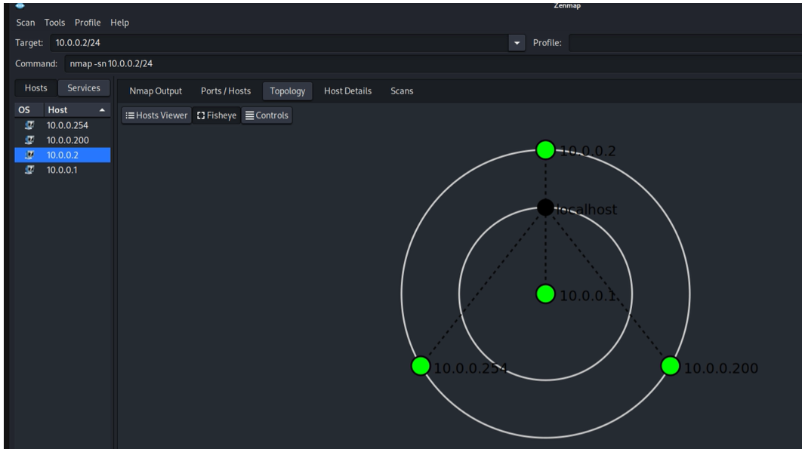

# NETWORKWALKS-ZAINAB-B084-WK2-PENETRATION-TESTING

**Week 2 – Footprinting, Reconnaissance & Network Scanning**

## 1. Project Overview

As part of my Ethical Hacking Internship at Networkwalks Academy, I worked on this Week 2 project to explore the early stages of penetration testing.

The project focused on two main areas: Footprinting & Reconnaissance and Network Scanning. I used different Kali Linux tools to collect domain-related information and Zenmap to discover active devices on my local network.

This project gave me a chance to practise these concepts and understand how different tools are used during the initial stages of a security assessment.

## 2. Project Objectives

The main objectives of this project were to:

- Understand how footprinting and reconnaissance work.
- Collect publicly available information about a domain.
- Identify website technologies and HTTP response headers.
- Explore DNS records and domain information.
- Check for Web Application Firewall detection.
- Discover active hosts on my local network using Zenmap.
- Understand scan results and document the observations.

## 3. Authorization & Scope

The activities documented in this project involved:

- `networkwalks.com` – for public information gathering.
- My own local network for network host discovery.

The work was limited to the documented scope. No exploitation, brute-force attacks, denial-of-service activity or vulnerability validation was performed.

## 4. Tools & Technologies Used

During this project, I worked with:

- Kali Linux
- WHOIS
- WhatWeb
- Nslookup
- Curl
- Wafw00f
- DNSRecon
- Zenmap
- Nmap 7.95

---

# 5. Phase 1 – Footprinting & Reconnaissance (W2-PM1)

In the first phase, I used six different tools to understand what information could be gathered about the target domain.

## 5.1 WHOIS – Domain Information

WHOIS helps retrieve domain registration details, such as registrar information, registration dates, domain status and name servers.

**Command Used:**

```bash
whois networkwalks.com
```

**What I Observed:**

- The registrar was reported as GoDaddy.com, LLC.
- The name servers were NS6135.HOSTGATOR.COM and NS6136.HOSTGATOR.COM.
- Four registrar lock status flags were displayed.
- DNSSEC was reported as unsigned.
- Registrant details were not available in my captured results.

**Screenshot 2: WHOIS Lookup**



## 5.2 WhatWeb – Website Technology Identification

WhatWeb helps identify technologies used by a website, including its web server, CMS, plugins and JavaScript libraries.

**Command Used:**

```bash
whatweb networkwalks.com
```

**What I Observed:**

- Apache web server was reported.
- WordPress 7.1.4 was identified.
- WordPress Download Manager 3.3.76 was reported.
- jQuery 3.7.1 was identified.
- The HTTP request was redirected to HTTPS.

These are the versions reported by the tool and were not independently verified.

**Screenshot 3: WhatWeb Scan**



## 5.3 Nslookup – DNS Lookup

Nslookup is used to check how a domain name is resolved into an IP address. It also helps identify the DNS server responding to the query.

**Command Used:**

```bash
nslookup networkwalks.com
```

**What I Observed:**

- DNS resolver: 8.8.8.8
- Response type: Non-authoritative answer
- Resolved IP address: 192.232.216.135

This helped me understand how DNS resolution works in practice.

**Screenshot 4: Nslookup Results**



## 5.4 Curl – HTTP Response Headers

Curl is a command-line tool that allows us to communicate with web servers. I used its `-I` option to view the HTTP response headers.

**Command Used:**

```bash
curl -I https://networkwalks.com
```

**What I Observed:**

- HTTP response: 200 OK
- Server header: Apache
- WordPress REST API information was visible in the Link header.
- The observed cookie included Secure and HttpOnly flags.
- Some security headers were not present in this captured response.

These observations would need further checking before drawing any security conclusions.

**Screenshot 5: Curl Response Headers**



## 5.5 Wafw00f – WAF Detection

Wafw00f is used to check whether a website is protected by a Web Application Firewall (WAF).

**Command Used:**

```bash
wafw00f networkwalks.com
```

**What I Observed:**

- Tool version: WAFW00F v2.3.1
- ModSecurity (SpiderLabs) was identified.
- Two requests were sent during the detection process.

This helped me understand how WAF detection tools analyse website responses.

**Screenshot 6: Wafw00f Results**



## 5.6 DNSRecon – DNS Enumeration

DNSRecon is used to collect DNS-related information, including SOA, NS, MX, A, TXT and SRV records.

**Command Used:**

```bash
dnsrecon -d networkwalks.com
```

**What I Observed:**

- SOA and NS records were identified.
- A and MX records were returned.
- TXT records included an SPF policy.
- Eight SRV records were reported.
- The DNSSEC query returned no answer.
- BIND version information was displayed for the name-server addresses.

This activity helped me become more familiar with DNS enumeration and the different types of DNS records.

**Screenshot 7: DNSRecon Results**



---

# 6. Phase 2 – Network Scanning with Zenmap (W2-PM5)

For the second phase, I used Zenmap, the graphical interface of Nmap, to perform host discovery on my own local network.

## 6.1 Zenmap – Network Scan

Zenmap makes it easier to configure scans and review Nmap results through a graphical interface.

**Target Network:**

```text
10.0.0.2/24
```

**Command Used:**

```bash
nmap -sn 10.0.0.2/24
```

The `-sn` option performs host discovery without conducting a port scan.

**What I Observed:**

- Network range scanned: 256 IP addresses.
- Four hosts were reported as up.
- Discovered IP addresses:
  - 10.0.0.1
  - 10.0.0.200
  - 10.0.0.254
  - 10.0.0.2
- Three discovered hosts displayed VMware MAC addresses.

This gave me a better understanding of how Nmap identifies active hosts on a network.

**Screenshot 8: Zenmap Scan Results**



## 6.2 Zenmap – Network Topology

After the scan, I also explored Zenmap's Topology view. It provides a graphical representation of the discovered hosts and their relationship to the scanning machine.

**What I Observed:**

- Four discovered hosts were displayed.
- The scanning machine appeared as the central localhost node.
- Other discovered hosts appeared around the central node.
- Dashed lines indicated that traceroute information was unavailable.

The topology helped me visualise the scan results more clearly. It does not confirm the physical network layout.

**Screenshot 9: Zenmap Network Topology**



---

# 7. Risk Analysis & Findings

While reviewing the results, I documented the following observations:

| Finding | Observation | Risk Level |
|---|---|---|
| F-01 | Website technology and version information was visible. | Low |
| F-02 | Domain resolved to a public IP address. | Informational |
| F-03 | WordPress REST API and server details appeared in headers. | Informational |
| F-04 | Some security headers were absent in the captured response. | Low – To be verified |
| F-05 | ModSecurity WAF was identified. | Informational |
| F-06 | DNSSEC was reported as unsigned. | Low |
| F-07 | BIND version information was displayed. | Low |
| F-08 | DNS and mail-related records were publicly available. | Informational |
| F-09 | Four active hosts were discovered on the local network. | Informational |

These are initial observations and potential security hardening areas, not confirmed vulnerabilities.

# 8. Security Recommendations

Based on the observations, I included the following recommendations:

1. Keep website software, CMS, plugins and libraries updated.
2. Review and configure appropriate HTTP security headers.
3. Review publicly accessible WordPress REST API routes.
4. Regularly review DNS records and remove outdated entries.
5. Review DNSSEC and verify SPF, DKIM and DMARC configurations.
6. Keep the WAF updated and properly configured.
7. Maintain domain registration and renewal controls.
8. Regularly check the local network for unknown devices.
9. Perform additional security testing only with proper authorization.
10. Keep clear records of security observations and assessment results.

# 9. Limitations

There were some limitations to this project:

- Host discovery may not identify every device on a network.
- No port scanning, service detection or OS detection was performed.
- No exploitation or vulnerability validation was performed.
- Some software versions were not independently verified.
- Results represent observations from a single testing period.
- The supplied evidence did not establish every network configuration detail.

# 10. What I Learned

This project helped me get more comfortable with different cybersecurity tools and their practical uses.

I learned how to:

1. Gather domain information using WHOIS.
2. Identify website technologies using WhatWeb.
3. Understand DNS resolution and enumeration.
4. Review HTTP response headers using Curl.
5. Understand the purpose of WAF detection.
6. Discover active network hosts using Zenmap and Nmap.
7. Review technical results and document potential risks.
8. Prepare a structured penetration testing report.

# 11. Complete Project Report

I have also prepared a detailed report covering both project modules, including commands, screenshots, observations, findings, recommendations and limitations.

**Project Report: WK2.pdf**

[View / Download Complete Week 2 Report](Week2.pdf)

# 12. Conclusion

Overall, this project was a useful hands-on learning experience. It helped me understand how information gathering and network scanning are used during the initial stages of penetration testing.

Working with different Kali Linux tools and Zenmap also gave me more confidence in analysing results and documenting technical observations.

I look forward to applying what I have learned in the upcoming internship tasks.

# 13. Security & Ethical Use

This project was completed for educational purposes within the documented scope. All cybersecurity activities should be performed only on systems for which proper authorization has been obtained.

# 14. Project Information

- **Program:** Networkwalks Ethical Hacking Internship
- **Batch:** B084
- **Week:** 02
- **Modules:** W2-PM1, W2-PM5, W2-PM-FINAL
- **Platform:** Kali Linux
- **Network Scanning Tools:** Zenmap / Nmap

## Author

**Zainab Zulfiqar**

Ethical Hacking Intern  
Networkwalks Academy

*Learning and improving through practical cybersecurity projects.*
